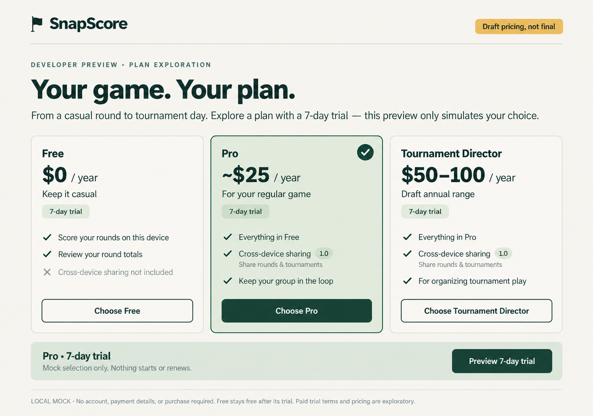
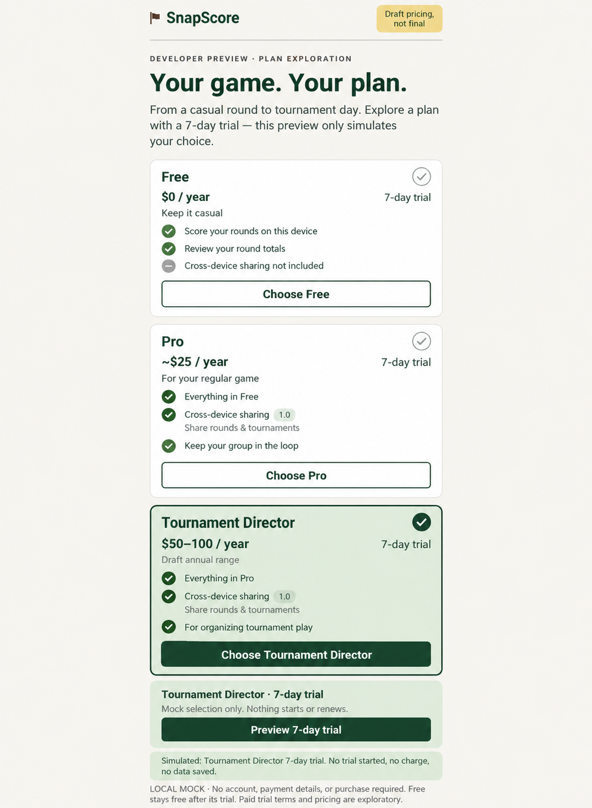

# SnapScore: explore draft plans in a local-only mock

## For Augie
**Problem:** Golfers cannot compare a lightweight Free plan with paid sharing and tournament options.
**Bet:** A one-screen picker makes ~$25/year Pro and $50–100/year Tournament Director understandable, with 1.0 cross-device sharing as the paid benefit.
**How we will know:** In a walkthrough, a golfer can identify the sharing tier, repeat the draft price range, and preview a 7-day trial without expecting a real purchase.

## What to tap

Choose Free, Pro (selected initially), or Tournament Director. The selected card and summary update. Tap **Preview 7-day trial** for an inline simulation message; switch plans to repeat. Every plan shows a 7-day trial; Free explicitly stays free. “Draft pricing, not final” remains visible at the top. All feature descriptions are exploratory mock copy, not entitlement promises.

## How to run

From the repository root:

```sh
python3 prototypes/snapscore-plan-picker/preview.py --preview
```

Open `http://127.0.0.1:8765/dev/plan-picker`. Use `--port 8766` if needed. Stop with Ctrl-C. Alternatively open `prototypes/snapscore-plan-picker/index.html` directly in a browser; it needs no server or dependencies.

This standalone developer preview is outside `scoresnap/app`, `scoresnap/src`, and the public site. There are no links or imports from the product, no package/build changes, and no shipping app route. The local server requires `--preview`, binds only to loopback, serves only the explicit developer route, and disables caching. The page contains no external assets, account calls, purchase SDKs, payments, API calls, or persistence; CSP also forbids connections. No real trial or sharing action occurs.

## Validation and limits

Checked all available git branches/history and existing prototype folders: prior work concerns recap cards, local guest-join trust, and missing OCR holes. This picker is new.

A dependency-free Node VM check passed for initial Pro trial simulation, all three plan selections, mutually exclusive selected/pressed state, and per-plan trial feedback. Static checks found no network/storage integrations. The server rejects startup without `--preview` (exit 2). Logs are in the run's `_out` directory.

**Rendering limitation:** This sandbox forbids socket operations. Local server startup, Google Chrome headless, and ungoogled Chromium headless failed before rendering. The PNGs below are faithful **AI-generated mock images using the built-in imagegen tool**, not browser screenshots. Desktop shows the initial Pro choice; phone shows Tournament Director after simulated trial. Actual browser layout and assistive technology behavior remain unverified. Phone uses a single scrolling screen.

## Mock images





Image prompts: built-in imagegen was given the implemented page's ivory/forest palette, system typography, exact plan prices, benefits, trial labels, disclaimer, card layout, and simulation copy. Desktop requested three columns with Pro selected; phone requested stacked cards with Tournament Director selected and simulation feedback. Generated details can differ cosmetically from the HTML; use the code for exact behavior.
