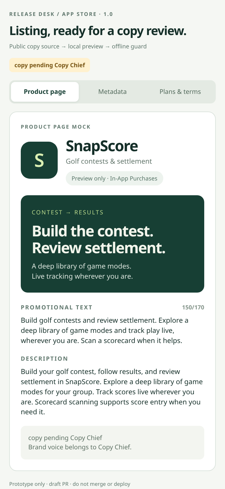
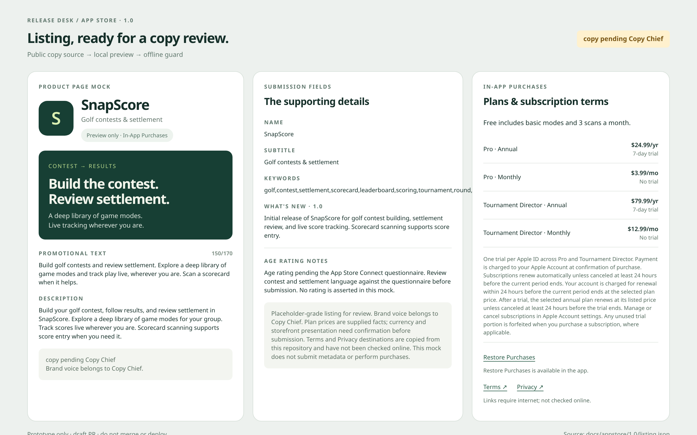

# SnapScore: a guarded App Store listing review kit

## For Augie
**Problem:** Listing text and subscription details need a compact review surface with enforceable copy boundaries.
**Bet:** A shared source file, local product-page preview, and offline copy guard make the draft easy to review and revise.
**How we will know:** A reviewer can find every listing field and plan term, and prohibited wording makes the copy check fail.

Prototype only - draft PR, do not merge or deploy

**copy pending Copy Chief**. Neutral placeholder copy; brand voice belongs to Copy Chief.

## What to tap

Open the desktop render to review the product page, submission fields, and plan terms together. At phone width, tap **Product page**, **Metadata**, or **Plans & terms**. Tap **Restore Purchases** for a local preview explanation. Terms and Privacy are real outbound links copied from the repo; their availability has not been checked online. Nothing calls an account or purchase API.

Positioning starts with contest building and settlement, followed by a deep game library and live tracking anywhere. Scanning is supporting copy. Plan rows preserve the supplied prices and annual trial terms, with a shared Apple ID trial restriction and auto-renewal disclosure. Age rating is explicitly pending the questionnaire.

## How to run

From the repository root, with Node already installed:

```sh
node scripts/check-appstore-copy.mjs
node scripts/check-appstore-copy.mjs --self-test
node scripts/render-appstore-proto.mjs
node scripts/render-appstore-proto.mjs --check
node --test --test-isolation=none scripts/appstore-copy.test.mjs
node --test --test-isolation=none scoresnap/e2e/usability-gate.test.mjs
```

Open `render/01-phone.html` at 390×844 or `render/02-desktop.html` at 1280×800. Both are self-contained and generated from `docs/appstore/1.0/listing.json`; no dependencies or local server are needed.

## Validation

Copy guard, adversarial fixtures, nested rejection and plan-fact tests, and generated render freshness: passed. Existing offline usability-gate check: passed. Tests use in-process isolation because child-process spawning is restricted in this sandbox. App Jest suite is unavailable because dependencies are not installed; no install attempted.

Local Chrome rendering was attempted, but the sandbox rejected Chrome's crashpad socket operation (`setsockopt: Operation not permitted`). Visual and interaction verification in a browser remains for the coordinator. The screenshot paths below are coordinator render targets; PNGs are not fabricated.

## Scope and prior work

Only `docs/` and `scripts/` changed. No app code, StoreKit, App Store Connect assets, dependencies, configuration, or lockfiles changed. No network calls or commits were made. The local branch and main have the same historical prototype assets. Git history, all available branch prototype trees, prior prototype state files, and yesterday's result were checked. The earlier listing mock was a copy review surface; this kit adds a reusable source, automated copy rejection, and reproducible local renders. It does not repeat yesterday's plan-picker interaction.

## Screenshots




